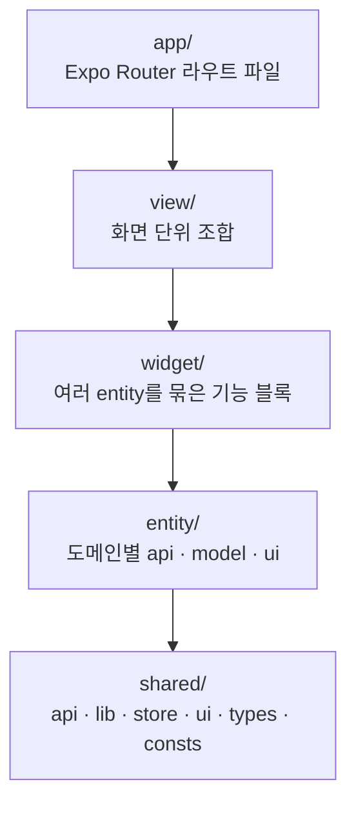
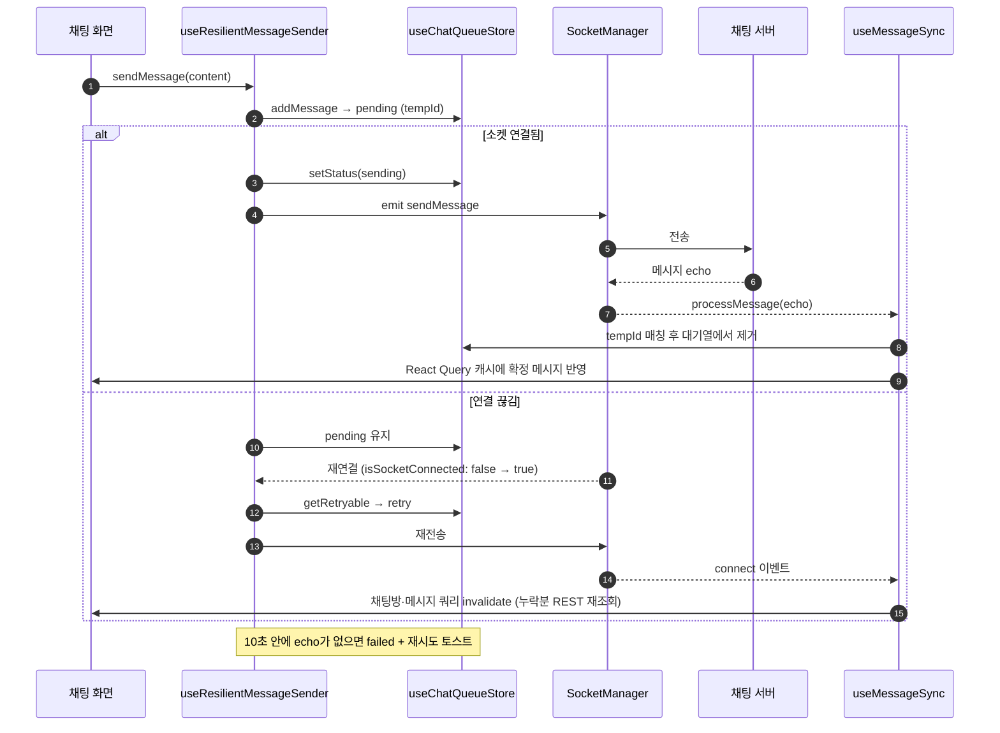

# 시민화폐 광산

[](https://github.com/School-of-Company/Gwangsan-Crossplatform/actions/workflows/ci.yml)
[](https://github.com/School-of-Company/Gwangsan-Crossplatform/actions/workflows/codeql.yml)
[](https://github.com/School-of-Company/Gwangsan-Crossplatform/actions/workflows/secret-scan.yml)


광산구 주민 화합을 위한 지역 화폐 거래 관리 서비스

- 시민화폐 광산은 광주광역시 광산구의 외주 프로젝트로, 지역 내에서 가상의 화폐 '광산'을 활용해 거래를 할 수 있도록 구축한 플랫폼입니다.
- 사용자는 앱에서 거래 게시글과 실시간 채팅 기능을 통해 다른 사용자와 물건·서비스를 자유롭게 교환할 수 있습니다.

## 한눈에 보기

| 항목                         | 값                                                                  |
| ---------------------------- | ------------------------------------------------------------------- |
| 단위 테스트                  | 295개 스위트 / 3,144개 테스트 (Jest + React Native Testing Library) |
| 커버리지                     | Lines 98.5% · Statements 97.6% · Functions 96.5% · Branches 92.6%   |
| 커버리지 하한 (CI 실패 기준) | Lines 95 · Statements 95 · Functions 93 · Branches 88               |
| 레이어 경계                  | FSD 5계층, 로컬 ESLint 규칙으로 `error` 강제                        |
| E2E                          | Detox(iOS 시뮬레이터) 인프라 구축 단계 — 시나리오 확장 중           |

> 위 수치는 `develop` 기준 `npm run test:coverage` 실행 결과입니다. PR마다 `Unit Test Coverage` job이 커버리지 리포트를 코멘트로 남깁니다.

## 기술 스택

| 분류       | 사용 기술                                                               |
| ---------- | ----------------------------------------------------------------------- |
| 프레임워크 | Expo SDK 56, React Native 0.85 (New Architecture, Hermes), React 19     |
| 언어       | TypeScript 6                                                            |
| 라우팅     | Expo Router (파일 기반)                                                 |
| 상태 관리  | React Query 5 (서버 상태), Zustand 5 (UI·폼 상태)                       |
| 스타일     | NativeWind 4 (Tailwind CSS 3)                                           |
| 네트워크   | Axios (Bearer 토큰, 401 재발급), Socket.io Client 4 (채팅)              |
| 저장소     | Expo SecureStore / Keychain (토큰·생체 인증), AsyncStorage              |
| 모니터링   | Sentry (`@sentry/react-native`)                                         |
| 테스트     | Jest 29 (`jest-expo`), React Native Testing Library 13, MSW 2, Detox 20 |
| CI/CD      | GitHub Actions, EAS Build / Submit                                      |

## 아키텍처

### FSD 레이어

[Feature-Sliced Design](https://feature-sliced.design/)을 변형해 5개 레이어로 나눕니다. import는 위에서 아래로만 허용합니다.



- `entity`·`widget`·`view`는 도메인 슬라이스(`chat`, `post`, `profile` …)로 나뉘고, **같은 레이어의 다른 슬라이스는 import할 수 없습니다.**
- 규칙은 문서로만 있을 때 위반이 18건까지 쌓였기 때문에, 로컬 ESLint 규칙으로 강제합니다.
  - 규칙 구현: [`scripts/eslint/fsd-layers.js`](scripts/eslint/fsd-layers.js) — `~/`·`@/` 별칭과 상대 경로를 실제 경로로 풀어 레이어·슬라이스를 판정
  - 적용: [`eslint.config.js`](eslint.config.js)에서 `src/**/*.{ts,tsx}`에 `fsd/layer-imports: error`
  - 규칙 자체의 테스트: [`scripts/eslint/__tests__/fsd-layers.test.js`](scripts/eslint/__tests__/fsd-layers.test.js)
- 자세한 배경: [ADR-0001](docs/adr/0001-fsd-layers-enforced-by-lint.md)

### 상태 관리 역할 분리

| 종류       | 위치                                                 | 예                                         |
| ---------- | ---------------------------------------------------- | ------------------------------------------ |
| 서버 상태  | React Query (`staleTime` 5분, 4xx는 재시도하지 않음) | 게시글, 채팅방 목록, 프로필                |
| UI·폼 상태 | Zustand (`src/shared/store/`)                        | 회원가입 단계, 채팅 전송 대기열, 읽음 표시 |
| 토큰       | SecureStore / Keychain                               | access·refresh 토큰, 생체 인증용 사본      |

자세한 배경: [ADR-0002](docs/adr/0002-zustand-react-query-separation.md)

## 채팅 설계

채팅은 REST(목록·이전 메시지)와 Socket.io(실시간 송수신)를 함께 씁니다.

- **소켓 싱글턴** — [`src/shared/lib/socket.ts`](src/shared/lib/socket.ts)의 `SocketManager`가 앱 전체에서 연결 하나만 유지합니다. 재연결 때마다 `auth` 콜백이 저장소에서 최신 access 토큰을 다시 읽으므로, 토큰이 재발급된 뒤에도 만료된 토큰으로 붙지 않습니다.
- **전송 대기열·재시도** — [`useChatQueueStore`](src/shared/store/useChatQueueStore.ts)가 보낸 메시지를 `pending → sending → sent / failed` 상태로 들고 있고, [`useResilientMessageSender`](src/entity/chat/hooks/useResilientMessageSender.ts)가 실제 전송을 맡습니다.
  - 연결이 끊긴 상태에서 보낸 메시지는 `pending`으로 남았다가 재연결 시 자동 재전송됩니다.
  - 10초 안에 서버 echo가 없으면 `failed`로 바꾸고 "탭해서 재시도" 토스트를 띄웁니다.
  - Expo Router 스택은 이전 화면을 언마운트하지 않아 같은 방의 훅이 여러 개 살아 있을 수 있으므로, 방마다 **자동 재시도 담당 인스턴스를 하나만** 두어 중복 전송을 막습니다.
- **재연결 동기화** — [`useMessageSync`](src/entity/chat/model/useMessageSync.ts)는 다시 연결되면 채팅방·메시지 쿼리를 무효화해 끊겨 있던 동안의 메시지를 REST로 다시 받고, 서버 echo를 대기열의 임시 메시지와 맞춰 확정합니다(내가 보낸 echo만, 이미지 메시지는 이미지 ID 또는 FIFO로 매칭).



자세한 배경: [ADR-0003](docs/adr/0003-chat-send-queue.md)

## 토큰 갱신 동시성 제어

[`src/shared/lib/axios.ts`](src/shared/lib/axios.ts)의 응답 인터셉터가 401을 받으면 refresh 토큰으로 access 토큰을 재발급하고 원래 요청을 다시 보냅니다.

- **재발급은 한 번만** — 진행 중인 재발급을 `refreshPromise` 하나로 공유해, 동시에 401을 받은 요청들이 모두 같은 재발급 결과를 기다립니다.
- **늦게 도착한 401** — 요청이 보낸 토큰과 저장소의 최신 토큰이 다르면(이미 다른 요청이 재발급함) 재발급 없이 새 토큰으로 재시도합니다.
- **refresh 토큰 교체** — 서버가 새 refresh 토큰을 내려주면 함께 저장합니다.
- **로그아웃하지 않는 실패** — 기기 잠금으로 Keychain을 읽지 못한 경우(`TokenStorageError`)나 네트워크·타임아웃은 요청만 실패시키고 세션은 유지합니다.
- **세션 만료** — 재발급이 불가능하면 세션을 정리하고 안내 토스트를 **한 번만** 띄운 뒤 로그인 화면으로 이동합니다.

이 흐름은 [`src/shared/lib/__tests__/axios.test.ts`](src/shared/lib/__tests__/axios.test.ts)의 26개 테스트로 검증합니다(동시 401, 늦게 도착한 401, refresh 토큰 교체, 저장소 오류 등).

## 테스트 전략

| 종류          | 도구                                              | 설명                                                                                                       |
| ------------- | ------------------------------------------------- | ---------------------------------------------------------------------------------------------------------- |
| 단위·컴포넌트 | Jest (`jest-expo`) + React Native Testing Library | 훅·API·컴포넌트를 파일 옆 `__tests__/`에 둡니다.                                                           |
| HTTP 모킹     | MSW 2 (`src/mocks/`)                              | 일부 API 테스트에서 실제 요청 경로 그대로 응답을 모킹합니다.                                               |
| E2E           | Detox 20 (iOS 시뮬레이터)                         | **인프라 구축 단계**입니다. 앱 실행·로그인·프로필 기본 시나리오가 있고, 시나리오는 확장 중입니다.          |
| E2E 커버리지  | `babel-plugin-istanbul` + nyc                     | `E2E_COVERAGE=true`로 계측 빌드를 만들어 E2E 실행 중 커버리지를 모읍니다(`npm run e2e:test:ios:coverage`). |

- **타임존 고정** — 서버 REST 응답이 오프셋 없는 KST 문자열이라, [`jest.config.js`](jest.config.js)에서 `TZ=Asia/Seoul`로 고정합니다. ([ADR-0004](docs/adr/0004-fix-test-timezone.md))
- **커버리지 하한** — 실제 수준 바로 아래(Lines 95 / Statements 95 / Functions 93 / Branches 88)로 두어 테스트 없는 코드가 크게 늘면 CI가 실패합니다. ([ADR-0005](docs/adr/0005-raise-coverage-threshold.md))

## CI/CD

| 워크플로                                                                                            | 트리거                                  | 내용                                                                                                                           |
| --------------------------------------------------------------------------------------------------- | --------------------------------------- | ------------------------------------------------------------------------------------------------------------------------------ |
| [`ci.yml`](.github/workflows/ci.yml)                                                                | `main`·`develop` push / PR              | lint, `tsc --noEmit`, 단위 테스트(PR은 커버리지 리포트 코멘트), `expo install --check`, `npm audit`                            |
| [`test-ios.yml`](.github/workflows/test-ios.yml)                                                    | `main` 대상 PR, PR 코멘트 `/run-e2e`    | Detox iOS E2E. ccache·CocoaPods·Detox 프레임워크 캐시로 빌드 시간을 줄이고, `/run-e2e coverage`면 E2E 커버리지를 코멘트로 남김 |
| [`ios_cd.yml`](.github/workflows/ios_cd.yml) / [`android_cd.yml`](.github/workflows/android_cd.yml) | `main` push                             | EAS 클라우드 빌드 후 스토어 제출                                                                                               |
| [`pr-template-check.yml`](.github/workflows/pr-template-check.yml)                                  | PR                                      | PR 본문에 `## 💡 PR 요약`이 채워져 있지 않으면 실패 (`develop → main` PR 제외)                                                 |
| [`secret-scan.yml`](.github/workflows/secret-scan.yml)                                              | `main`·`develop` push / PR              | gitleaks CLI로 시크릿 유출 검사                                                                                                |
| [`codeql.yml`](.github/workflows/codeql.yml)                                                        | `main`·`develop` push / PR, 매주 일요일 | CodeQL 정적 분석                                                                                                               |
| [`weekly-pr.yml`](.github/workflows/weekly-pr.yml)                                                  | 매주 금요일                             | `develop → main` PR 자동 생성                                                                                                  |
| [`auto-update-prs.yml`](.github/workflows/auto-update-prs.yml)                                      | `develop`·`main` push                   | 열린 PR 브랜치를 최신 베이스로 갱신                                                                                            |

## 시작하기

### 요구 사항

- Node.js 22 (EAS 빌드 워크플로와 같은 버전)
- iOS: Xcode, CocoaPods / Android: Android Studio
- 네이티브 모듈을 쓰므로 Expo Go가 아닌 **개발 빌드**(`expo-dev-client`)로 실행합니다.

### 설치·실행

```bash
npm ci
# 아래 환경 변수 표를 참고해 프로젝트 루트에 .env 작성
npm run ios            # 또는 npm run android
npm start              # 이미 설치된 개발 빌드에 Metro만 띄울 때
```

### 자주 쓰는 명령

```bash
npm run lint             # ESLint + Prettier 검사
npm run format           # 자동 수정
npx tsc --noEmit         # 타입 검사
npm test                 # 단위 테스트
npm run test:coverage    # 커버리지 포함
npm run e2e:build:ios && npm run e2e:test:ios   # Detox E2E (iOS)
```

### 환경 변수

| 이름                             | 사용처                               | 설명                                                                                  |
| -------------------------------- | ------------------------------------ | ------------------------------------------------------------------------------------- |
| `API_URL`                        | `app.config.ts` → `extra.apiUrl`     | API 서버 주소. 없으면 `app.json`의 값(`https://api.gwangsan.io.kr/api`) 사용          |
| `EXPO_PUBLIC_SENTRY_DSN`         | `src/shared/lib/sentry.ts`           | Sentry DSN (앱 번들에 인라인)                                                         |
| `EXPO_PUBLIC_KAKAO_REST_API_KEY` | `src/shared/api/kakaoLocalSearch.ts` | 카카오 로컬(장소 검색) REST 키                                                        |
| `EXPO_PUBLIC_KAKAO_JS_KEY`       | 예약 장소 지도 WebView               | 카카오 지도 JavaScript 키                                                             |
| `SENTRY_DSN`                     | `app.config.ts` → `extra.sentryDsn`  | 네이티브 설정용 Sentry DSN                                                            |
| `SENTRY_ORG` / `SENTRY_PROJECT`  | `@sentry/react-native` config plugin | 소스맵 업로드 대상                                                                    |
| `SENTRY_AUTH_TOKEN`              | EAS 빌드                             | 소스맵 업로드 인증                                                                    |
| `GOOGLE_SERVICES_JSON`           | `app.config.ts`                      | Android Firebase 설정 파일 경로 (없으면 `./google-services.json`, 파일이 없으면 생략) |

`.env`는 커밋하지 않습니다. EAS 빌드에서는 EAS 환경 변수로 주입합니다.

## 주요 화면

> **TODO: 스크린샷/GIF 추가 필요** — 아래 화면을 실제 기기 또는 시뮬레이터에서 캡처해 이 섹션을 채워 주세요.

- [ ] 온보딩 / 로그인(생체 인증 포함)
- [ ] 메인 — 거래 게시글 목록
- [ ] 게시글 상세 · 작성
- [ ] 채팅방 목록 · 채팅방(메시지 전송, 전송 실패 후 재시도)
- [ ] 거래 예약 — 장소 선택(카카오 지도)·시간 선택
- [ ] 프로필 — 밝기(신뢰도), 판매 내역, 후기
- [ ] 알림 · 공지

## 문서

- [`docs/adr/`](docs/adr/) — 아키텍처 결정 기록
- [`CLAUDE.md`](CLAUDE.md), [`.claude/rules/`](.claude/rules/) — 코드 규칙(레이어, API·React Query·Zustand 패턴, NativeWind)
- [`.github/pull_request_template.md`](.github/pull_request_template.md) — PR 본문 템플릿
